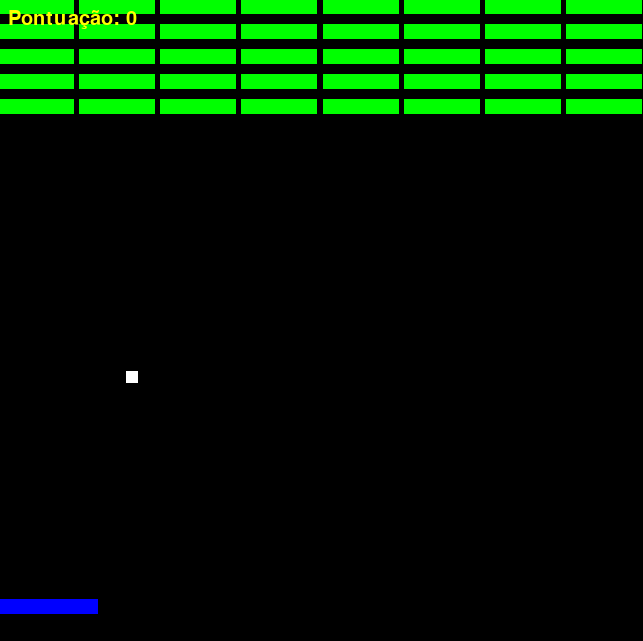

# 🎮 Brick Breaker

A simple Brick Breaker arcade game developed using Python and Pygame.

📌 About the Project

This project is a basic implementation of the classic Brick Breaker game. The player controls a paddle to bounce a ball and destroy all the bricks on the screen.

✨ Features

* Paddle movement using the left and right arrow keys.
* Ball movement and collision detection.
* 40 bricks arranged in 8 columns and 5 rows.
* Score tracking based on destroyed bricks.
* Win condition when all bricks are destroyed.
* Game ends when the ball falls below the screen.

🛠️ Technologies

* Python
* Pygame

▶️ How to Run

1. Clone this repository:

git clone https://github.com/nataliabourbon/brick-breaker.git

2. Navigate to the project folder:

cd brick-breaker

3. Install Pygame:

pip install pygame

4. Run the game:

python3 brickbreaker.py

🎮 Controls

Use the left (←) and right (→) arrow keys to move the paddle.

👩‍💻 Author

Natalia Bourbon - 
Information Systems student at the Center for Informatics (CIn), Federal University of Pernambuco (UFPE).
